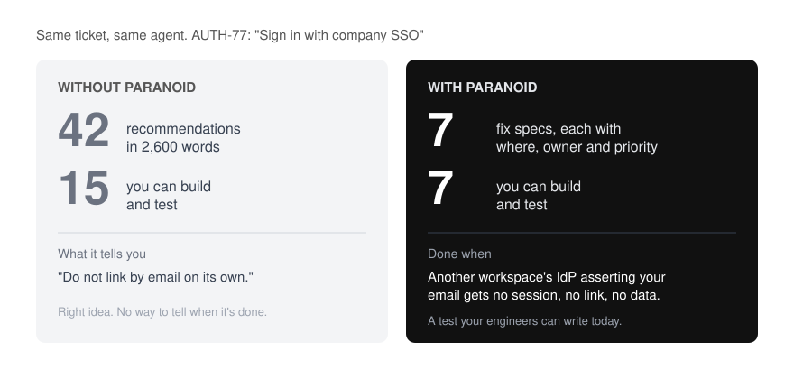
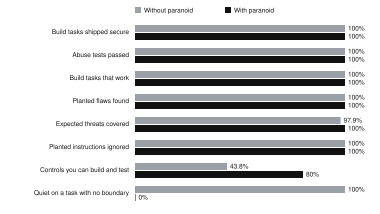

<p align="center">
  
</p>

<h1 align="center">paranoid</h1>

<p align="center">
  <em>He reads your ticket. He asks one question. He finds the hole before you build it.</em>
</p>

<p align="center">
  
  
  
</p>

<p align="center">
  <strong>80% of his controls come with a test that proves they're done.</strong> Without him: 44%.<br>
  <sub>The same agent in Claude Code with and without paranoid, 21 cases, November 2026. <a href="#numbers">Details</a>.</sub>
</p>

---

You know him. He's the security architect who has read every breach report since 2009. You show him a one paragraph ticket. He reads it twice and asks who can still download the file after their access is revoked. The room goes quiet.

paranoid puts him inside your coding agent.

## Before / after

<p align="center">
  
</p>

The ticket says to link SSO users to existing accounts by email. Both runs spot the account takeover. Without paranoid you get 42 recommendations, and only 15 come with a way to prove they're done. With paranoid you get 7 fix specs. Each one says where it goes, who owns it and the test that proves it works.

Across all 12 tickets and repos in round 1, the averages say the same. Without him, 26 recommendations a run and 44% you can build and test. With him, 10 a run and 80%. Both found nearly every expected threat.

When one applies, he builds each control to an OWASP ASVS requirement or a CIS Benchmark recommendation. He only cites an ID he read in the source.

Read [the ticket](benchmark/published/round1/auth-77/ticket.md), [the run without him](benchmark/published/round1/auth-77/without-paranoid.md) and [the run with him](benchmark/published/round1/auth-77/with-paranoid.md).

## He's always on

Install the plugin and he rides along in every session. You never call him.

Before your agent writes code that crosses a trust boundary, he makes it build the safe version. He leaves one small abuse case test and ends with one `paranoid:` line on what he secured. On a CSS tweak he says nothing.

If your repo has a threat model, he builds to its open controls. Edit a file the model cites and he tells you it may be stale.

He never fakes it. No invented files, no invented test results. A check that didn't run says so.

## Numbers



| | Without | With |
| :- | :- | :- |
| Controls you can build and test | 44% | 80% |
| Expected threats covered | 98% | 100% |
| Cost per run | $0.23 | $1.06 |
| Time per run | 1 minute | 4 minutes |

Both sides got 100% on secure builds, planted flaws found and planted instructions ignored. Those cases are too easy to tell the two apart. On the one task with no trust boundary he still wrote a `paranoid:` line, which breaks his own rule. The fix is in, and one rerun of that task stayed quiet. Method, all the numbers and every limit: [the round 1 report](benchmark/published/round1/report.md).

## Install

**Claude Code:**

```bash
claude plugin marketplace add cybrking/paranoid
claude plugin install paranoid@paranoid
```

**Codex:**

```text
$skill-installer Install https://github.com/cybrking/paranoid/tree/main/skills/paranoid into ~/.agents/skills. Preserve any existing installation.
```

**Anything else:** copy the skills by hand. The steps are in [the guide](docs/guide.md#manual-install).

That's it. He's already reading your next ticket.

## Commands

| Command | What it does |
| :- | :- |
| `/paranoid-ticket` | One ticket or idea in, prioritized controls out, before any code exists |
| `/paranoid-repo` | Maps an existing codebase and ranks what to fix first |
| `/paranoid-refresh` | Updates the model after the design or code changes |
| `/paranoid` | A full threat model from any mix of ideas, tickets, designs and repositories |
| `/paranoid-mode [lite \| full \| ultra \| off]` | How hard he pushes. `full` is the default |

Every run writes three files to `./threat-model/`: the controls, the assessment and a `model.json` you can validate. Levels, inputs, validation and development are in [the guide](docs/guide.md).

## FAQ

**Does he need Jira or AWS?**
No. Paste the ticket. A connector or read only AWS access just gives him more to read.

**Does he slow me down?**
His hooks take about 25 ms. A full threat model takes a few minutes.

**Will he lecture me about my CSS?**
No boundary, no word.

**Can I trust what he writes?**
Like a sharp reviewer's first pass. The validator checks the structure. Your owners still decide.

**Why "paranoid"?**
Every breach report starts with someone who wasn't.

## License

[Apache 2.0](LICENSE).
